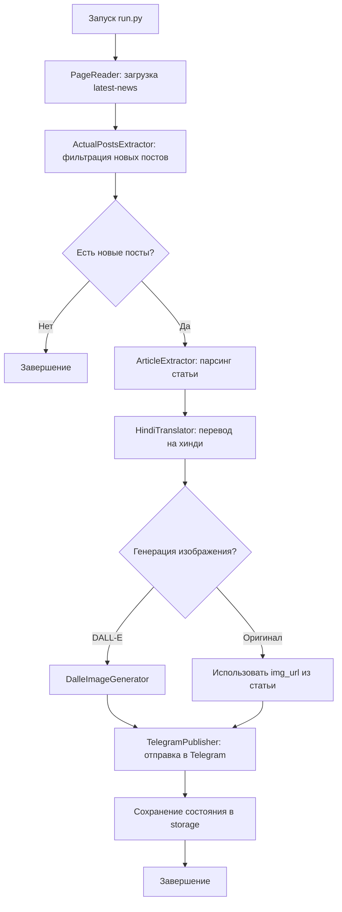

# Отчёт анализа проекта: Indonesian News Scrap Bot

## 📋 Общая информация

| Параметр | Значение |
|----------|---------|
| **Название** | Scrap Bot (indonesian_news) |
| **Язык** | Python 3.12 |
| **ОС** | macOS (разработка), Alpine Linux (контейнер) |
| **Дата анализа** | 17 июня 2026 |

---

## 🎯 Назначение проекта

Приложение представляет собой **автоматизированный бот для парсинга новостей** с сайта [Business Standard](https://www.business-standard.com/). Основная функциональность:

1. **Сбор новостей** — парсинг страницы `latest-news` с извлечением заголовков, дат, URL и изображений
2. **Перевод на хинди** — использование OpenAI GPT-3.5-turbo для перевода заголовков и статей
3. **Генерация изображений** — опциональная генерация иллюстраций через DALL-E 2
4. **Публикация в Telegram** — отправка переведённых новостей в Telegram-канал

---

## 📁 Структура проекта

```
indonesian_news/
├── .gitignore              # Игнорирование .env, кэша, storage данных
├── Makefile                # Команды сборки и запуска Docker
├── README.md               # Документация проекта
├── infra/
│   └── docker/
│       ├── docker-compose.yml   # Оркестрация контейнера
│       └── scrappy/
│           └── Dockerfile        # Образ на базе python:3.12-alpine
└── scrap/
    ├── .env-sample           # Шаблон переменных окружения
    ├── requirements.txt      # Зависимости Python
    ├── run.py                # Точка входа
    ├── dto/
    │   └── post_dto.py       # DTO для данных поста
    ├── web_input/
    │   ├── page_reader.py           # HTTP-клиент для загрузки страниц
    │   ├── page_extractor.py        # Парсинг списка новостей (BeautifulSoup)
    │   └── article_extractor.py     # Парсинг содержимого статьи
    ├── translate/
    │   └── hindi_translator.py      # Перевод через OpenAI API
    ├── generate/image/
    │   └── dalle_image_generator.py # Генерация изображений DALL-E 2
    ├── publish/telegram/
    │   └── telegram_publisher.py    # Публикация в Telegram
    ├── teaser/
    │   └── teaser_image_maker.py    # Создание teaser-изображений (Pillow)
    ├── resources/font/
    │   └── Devnew.ttf              # Шрифт для изображений
    └── storage/                    # Логи, состояние (git-игнорируется)
```

---

## 🔄 Архитектура и поток данных



### Компоненты

| Компонент | Файл | Назначение |
|-----------|------|------------|
| **PageReader** | [`page_reader.py`](scrap/web_input/page_reader.py:1) | HTTP-запросы с кукой `_sid` и заголовками браузера |
| **PageExtractor** | [`page_extractor.py`](scrap/web_input/page_extractor.py:1) | Извлечение заголовков, URL, дат, изображений из HTML |
| **ActualPostsExtractor** | [`actual_posts_extractor.py`](scrap/web_input/actual_posts_extractor.py:1) | Фильтрация уже отправленных постов по дате и URL |
| **ArticleExtractor** | [`article_extractor.py`](scrap/web_input/article_extractor.py:1) | Парсинг полного текста статьи и изображения |
| **HindiTranslator** | [`hindi_translator.py`](scrap/translate/hindi_translator.py:1) | Перевод через OpenAI GPT-3.5-turbo |
| **DalleImageGenerator** | [`dalle_image_generator.py`](scrap/generate/image/dalle_image_generator.py:1) | Генерация изображений через DALL-E 2 |
| **TelegramPublisher** | [`telegram_publisher.py`](scrap/publish/telegram/telegram_publisher.py:1) | Отправка сообщений/фото в Telegram |
| **TeaserImageMaker** | [`teaser_image_maker.py`](scrap/teaser/teaser_image_maker.py:1) | Создание изображений-превью с текстом (Pillow) |
| **PostDto** | [`post_dto.py`](scrap/dto/post_dto.py:1) | Простой DTO: title, url, dt, img_url, article |

---

## ⚙️ Конфигурация и зависимости

### Переменные окружения (`.env`)

| Переменная | Описание |
|------------|----------|
| `TELEGRAM_BOT_TOKEN` | Токен Telegram-бота |
| `TELEGRAM_CHAT_ID` | ID канала (например, `@BharatKiSamachar`) |
| `OPENAI_API_KEY` | Ключ API OpenAI |
| `SID` | Значение куки `_sid` с business-standard.com |

### Python-зависимости

| Пакет | Версия | Назначение |
|-------|--------|------------|
| beautifulsoup4 | 4.12.3 | Парсинг HTML |
| requests | 2.32.2 | HTTP-запросы |
| python-telegram-bot | 20.7 | Telegram API (установлен, но не используется) |
| python-dotenv | 1.0.1 | Загрузка `.env` |
| openai | 1.10.0 | OpenAI API (GPT + DALL-E) |
| pillow | 10.3.0 | Обработка изображений (закомментирована) |
| pyTelegramBotAPI | 4.9.0 | Альтернативный Telegram API (закомментирован) |

---

## 🐳 Docker-инфраструктура

- **Базовый образ**: `python:3.12-alpine`
- **Compose-сервис**: `scrappy` — монтирует `scrap/` в контейнер
- **Makefile-команды**:
  - `make build` — сборка образа
  - `make run` — запуск парсера
  - `make rebuild` — полная пересборка
  - `make sh` — интерактивный доступ в контейнер

---

## ⚠️ Выявленные проблемы и риски

### Критические

1. **Закомментированные зависимости** — `pillow` и `pyTelegramBotAPI` закомментированы в `requirements.txt`, но `TeaserImageMaker` использует `PIL`, а `TelegramPublisher` импортирует `Telebot`. Это приведёт к ошибкам при запуске соответствующих функций.

2. **Хрупкий парсинг по CSS-классам** — парсинг зависит от конкретных имён классов (`cardlist`, `MetaPost_metainfo__MmNP0`, `MainStory_storycontent__Pe3ys`), которые могут измениться при обновлении сайта.

3. **Только одна статья за запуск** — в [`run.py`](scrap/run.py:63) присутствует `break` после обработки первого поста, что ограничивает обработку одной статьёй за запуск.

4. **Незавершённая обработка изображений** — в [`teaser_image_maker.py`](scrap/teaser/teaser_image_maker.py:6) есть `TODO`, а основная логика закомментирована. Текущий код просто скачивает и сохраняет оригинальное изображение.

### Средние

5. **Отсутствие обработки ошибок сети** — нет повторных попыток при сетевых ошибках, таймауты не настроены.

6. **Небезопасное хранение состояния** — файлы `saved_date.txt` и `sent_urls.txt` хранятся в плоском виде без валидации.

7. **Неиспользуемая зависимость** — `python-telegram-bot` установлен, но в коде используется прямой HTTP через `requests` и `pyTelegramBotAPI`.

8. **Жёстко закодированные лимиты** — лимиты символов (4092, 1024) заданы как параметры функций, а не конфигурация.

### Низкие

9. **Смешанные стили логирования** — используются и `logging`, и `print` параллельно.

10. **Отсутствие тестов** — в проекте нет тестов.

11. **Неактуальный User-Agent** — в [`page_reader.py`](scrap/web_input/page_reader.py:20) указан Chrome 120, что может быть обнаружено как бот.

---

## 💡 Рекомендации

1. **Раскомментировать зависимости** или удалить неиспользуемый код
2. **Убрать `break`** в цикле обработки постов для полной обработки
3. **Добавить retry-логику** для сетевых запросов
4. **Добавить таймауты** в `requests.get()`
5. **Создать конфиг-файл** для лимитов и параметров
6. **Добавить unit-тесты** для парсеров
7. **Завершить реализацию** `TeaserImageMaker`
8. **Унифицировать логирование** — убрать `print` в пользу `logging`

---

## 📊 Итоговая оценка

| Критерий | Оценка |
|----------|--------|
| Полнота реализации | ⚠️ Частичная (закомментированный код, TODO) |
| Архитектура | ✅ Модульная, разделение по слоям |
| Надёжность | ⚠️ Хрупкий парсинг, нет retry |
| Безопасность | ⚠️ Секреты в .env (ок), но нет валидации |
| Поддерживаемость | ⚠️ Нет тестов, нет типизации |
| Документация | ✅ Базовая документация в README |

**Общий вывод**: Проект представляет собой рабочий прототип бота для парсинга и публикации новостей. Архитектура модульная и логичная, однако требуется доработка для стабильной работы: раскомментировать зависимости, убрать ограничивающий `break`, добавить обработку ошибок и завершить реализацию teaser-генератора.
